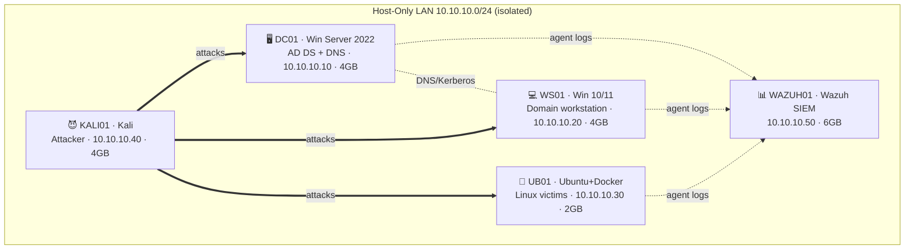

# security-homelab

A **reproducible, fully free** cybersecurity home lab for practising both **red-team**
(Active Directory attacks) and **blue-team** (SIEM detection) skills — engineered to
run on a **single 16 GB laptop** using VirtualBox.

The lab stands up a small Active Directory domain with realistic users and *intentional
misconfigurations*, ships rich Windows telemetry via **Sysmon**, and ingests everything
into a single-node **Wazuh** SIEM — so I can attack a target, then watch the attack turn
into an alert.

> **The design constraint that shapes everything:** a full AD + SIEM lab won't fit in
> 16 GB if every VM runs at once. So the lab runs in **phases** — the red-team VMs and
> Wazuh never run together (except one tightly-budgeted live-detection phase). Every
> phase is kept under ~12 GB. See **[docs/low-ram-operating-guide.md](docs/low-ram-operating-guide.md)**.

---

## Architecture



Full diagram, IP scheme, and per-VM RAM/CPU budget: **[docs/architecture.md](docs/architecture.md)**.

---

## What's in here

| Path | What it is |
|------|-----------|
| [`docs/architecture.md`](docs/architecture.md) | Network diagram, IP scheme, RAM/CPU budget, minimum-viable lab |
| [`docs/low-ram-operating-guide.md`](docs/low-ram-operating-guide.md) | Exactly which VMs to power on per phase + snapshotting |
| [`docs/verification.md`](docs/verification.md) | Checklist proving the lab works (with screenshot slots) |
| [`docs/reviewer-path.md`](docs/reviewer-path.md) | A 3-minute guided tour for a hiring manager |
| [`setup/00`–`05`](setup/) | Numbered, teach-as-you-go build guides |
| [`scripts/ad/`](scripts/ad/) | Idempotent PowerShell to build the domain + inject misconfigs |
| [`scripts/sysmon/`](scripts/sysmon/) | Sysmon install using the SwiftOnSecurity config |
| [`wazuh/`](wazuh/) | Single-node Wazuh docker-compose (secrets via gitignored `.env`) + [custom detection rules](wazuh/custom-rules/local_rules.xml) |
| [`victims/`](victims/) | Vulnerable Linux services as Docker containers |
| [`projects/`](projects/) | Red→Blue attack/detect walkthroughs (Kerberoasting, AS-REP, DCSync, BloodHound) |

---

## Quick bring-up

The lab spans several VMs, so "one command" isn't literal — but each component is
close to it. Full detail in [`setup/`](setup/); the short version:

```bash
# 1. Network: create the isolated host-only net (setup/01)

# 2. Active Directory (run on DC01, elevated PowerShell)
cd scripts/ad
./01-install-adds.ps1        # promote DC (reboots)
./02-seed-identities.ps1     # users, groups, OUs
./03-inject-misconfigs.ps1   # the intentional weaknesses

# 3. Sysmon on Windows hosts (DC01, WS01)
cd scripts/sysmon && ./install-sysmon.ps1

# 4. Wazuh SIEM (on WAZUH01)
cd wazuh
cp .env.example .env && nano .env      # set passwords
./generate-certs.sh
docker compose up -d                   # dashboard: https://10.10.10.50:5601

# 5. Wazuh agents on every host (setup/04), then Linux victims:
cd victims && docker compose up -d
```

Then work through **[docs/verification.md](docs/verification.md)**.

## Teardown

```bash
# Linux victims / Wazuh
cd victims && docker compose down -v
cd wazuh   && docker compose down -v
# VMs: restore the clean snapshot or power off (see low-ram guide)
```
To pause between sessions without losing state, `VBoxManage controlvm <VM> savestate`
or restore a snapshot — see the [operating guide](docs/low-ram-operating-guide.md).

---

## Showcase

A quick highlight reel of what this repo demonstrates — the parts I'm proudest of:

- **🧠 Constraint-driven engineering.** A complete AD + SIEM detection lab that runs on
  16 GB by phasing workloads — every phase budgeted under 12 GB, with a documented
  8 GB minimum-viable variant. → [architecture](docs/architecture.md) ·
  [operating guide](docs/low-ram-operating-guide.md)
- **⚔️ Offense + defense of the same findings.** Four intentional AD misconfigurations
  (Kerberoasting, AS-REP roasting, DCSync, Domain Admins nesting), each annotated with
  the attack (MITRE ATT&CK IDs) *and* how a defender detects it. →
  [03-inject-misconfigs.ps1](scripts/ad/03-inject-misconfigs.ps1)
- **🔭 Real detection pipeline.** Sysmon (SwiftOnSecurity config) → Wazuh single-node,
  ending in a live Kerberoast attack that produces a Wazuh alert. →
  [verification](docs/verification.md)
- **📓 Red→Blue project walkthroughs.** Four end-to-end projects that attack a
  misconfiguration and then detect it with a matching custom Wazuh rule. →
  [projects](projects/)
- **🔐 Secure by construction.** Zero secrets in git — runtime-prompted passwords,
  gitignored `.env`, locally-generated certs, referenced (not vendored) ISOs/configs.
- **♻️ Reproducible.** Numbered guides + idempotent scripts rebuild the whole lab from
  scratch. 100% free tooling.

**→ Hiring manager?** Start with the [3-minute reviewer path](docs/reviewer-path.md).

---

## Skills demonstrated

| Area | Evidence in this repo |
|------|-----------------------|
| **Active Directory** | Forest install, OU/user/group design, SPNs, ACL/replication rights, group nesting |
| **Red team** | Kerberoasting, AS-REP roasting, DCSync, BloodHound-findable priv-esc paths |
| **Blue team / SIEM** | Wazuh deployment, agent fleet, Sysmon telemetry, detection validation |
| **Detection engineering** | Mapping each attack to its Windows event IDs + MITRE ATT&CK technique |
| **Infrastructure / IaC** | Idempotent PowerShell, docker-compose, reproducible network design |
| **Security hygiene** | Secret management, network isolation, safe handling of vulnerable systems |
| **Technical writing** | Teach-as-you-go guides, reviewer path, verification evidence |

---

## Safety & scope

This lab contains **deliberately vulnerable systems and a deliberately weakened AD
domain**. Everything runs on an **isolated host-only network** with internet access
(NAT) detached during attack phases. Nothing here should ever be exposed to a real
network. For authorised learning and portfolio use only.

## License

[MIT](LICENSE) © 2026 Felix Githure
