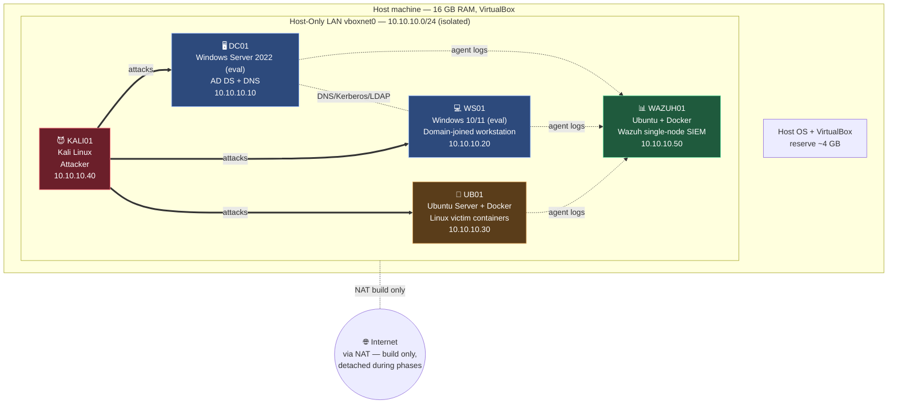

# Lab Architecture

This document defines the network topology, IP scheme, and per-VM resource budget
for the `security-homelab`. The lab is intentionally sized to run on a **16 GB host**
by never powering on every machine at once — see
[low-ram-operating-guide.md](low-ram-operating-guide.md).

> **Reviewer note:** the whole design pivots on one constraint — I never run the
> red-team VMs and the SIEM simultaneously. That trade-off is what makes a full
> AD + SIEM detection lab fit in 16 GB. Look at the phase table below and in the
> low-RAM guide to see how I budgeted it.

---

## Network topology

All lab traffic lives on an **isolated network** so nothing leaks onto the home LAN
and no host on the home LAN can touch the vulnerable machines. Two VirtualBox network
modes are used per adapter:

- **Host-Only network (`vboxnet0`, 10.10.10.0/24)** — the lab LAN. All VMs talk to
  each other and to the host here. This carries all attack + detection traffic.
- **NAT (per-VM)** — a *second, optional* adapter used **only** to pull updates,
  Docker images, and agent installers during build. I disable/detach it once a VM
  is configured so the lab is fully isolated during attack/detection phases.

---

## IP scheme

| Host      | Role                              | IP address     | DNS server        | Notes |
|-----------|-----------------------------------|----------------|-------------------|-------|
| DC01      | Domain Controller (AD DS + DNS)   | 10.10.10.10    | 127.0.0.1 (self)  | Authoritative DNS for `lab.local` |
| WS01      | Domain-joined workstation         | 10.10.10.20    | 10.10.10.10 (DC)  | Sysmon + Wazuh agent |
| UB01      | Linux victim (Docker host)        | 10.10.10.30    | 10.10.10.10 (DC)  | Runs deliberately vulnerable containers |
| KALI01    | Attacker                          | 10.10.10.40    | 10.10.10.10 (DC)  | Points DNS at DC so AD name resolution works during attacks |
| WAZUH01   | Wazuh single-node SIEM            | 10.10.10.50    | 10.10.10.10 (DC)  | Dashboard on `https://10.10.10.50:5601`(*)|

- Domain: **`lab.local`** — NetBIOS `LAB`.
- Gateway: none required on the host-only net (isolated). NAT adapter (build-only)
  gets DHCP from VirtualBox's NAT engine.
- Static IPs are set inside each guest so addresses survive reboots and snapshots.

(*) Wazuh 4.x serves its dashboard on port **5601** (or **443** depending on the
compose file); the exact port is pinned in [../setup/03-wazuh-siem.md](../setup/03-wazuh-siem.md).

---

## Per-VM resource budget (full lab)

| VM        | vCPU | RAM (full) | RAM (min-viable) | Disk  | When it runs |
|-----------|------|-----------|------------------|-------|--------------|
| DC01      | 2    | 4 GB      | **2 GB**         | 40 GB | Always (AD is the lab's backbone) |
| WS01      | 2    | 4 GB      | 2 GB             | 40 GB | Blue phases, live-detection |
| UB01      | 1    | 2 GB      | 1 GB             | 20 GB | When targeting Linux victims |
| KALI01    | 2    | 4 GB      | 2 GB             | 40 GB | Red / live-detection phases |
| WAZUH01   | 2    | 6 GB      | 4 GB             | 50 GB | Blue / live-detection phases |

**Why these numbers.** Wazuh (OpenSearch + indexer + manager + dashboard) is the
memory hog — it wants ~6 GB to be comfortable and is the reason the whole lab can't
run at once. Kali and the Windows hosts are fine at 4 GB. The DC can be squeezed to
2 GB for short-lived validation runs because it's only serving Kerberos/LDAP/DNS to a
tiny domain.

> If every VM above ran together it would be **20 GB** — over budget on a 16 GB host.
> That is exactly why the lab is phased.

---

## Phase budgets (this is the key design)

| Phase | VMs powered ON | RAM used | Under 12 GB? |
|-------|----------------|----------|--------------|
| **Red — attack** | KALI01 (4) + target: WS01 (4) **or** UB01 (2) | 6–8 GB | ✅ |
| **Red — AD attack** | KALI01 (4) + DC01 (4) + WS01 (4) | 12 GB | ✅ (tight) |
| **Blue — detection** | WAZUH01 (6) + target + DC01 (4) | ~10–12 GB | ✅ |
| **Live-detection validation** | DC01 (**2**) + WAZUH01 (6) + KALI01 (4) | 12 GB | ✅ |

The **live-detection** phase is the tightest: it's the only time attacker + SIEM +
DC run together. I drop DC01 to **2 GB** for that phase specifically. Full walk-through
in [low-ram-operating-guide.md](low-ram-operating-guide.md).

---

## Minimum-viable (scaled-down) lab

For a host with **8 GB RAM**, or when I just want to prove one thing at a time:

1. **Drop UB01.** Run the Linux victim containers directly on **WAZUH01's** Docker
   engine (it already has Docker). Saves a whole VM.
2. **Skip WS01 for AD attacks.** Kerberoasting, AS-REP roasting, and BloodHound
   collection can be driven against **DC01** alone from Kali.
3. **Run DC01 at 2 GB and WAZUH01 at 4 GB.** OpenSearch will be slower but functional
   for a single-agent demo.

Minimum-viable footprint to demonstrate the full **attack → log → detect** loop:

| VM      | RAM  |
|---------|------|
| DC01    | 2 GB |
| WAZUH01 | 4 GB |
| KALI01  | 2 GB |
| **Total** | **8 GB** |

This proves the end-to-end pipeline (attack an AD misconfig → Sysmon/Windows logs →
Wazuh alert) on an 8 GB laptop.

---

## Design decisions & why they're defensible

- **One Windows workstation, not two.** A second workstation adds 4 GB for almost no
  new learning — lateral movement can be demonstrated DC→WS with a single workstation.
- **Linux victims as containers, not VMs.** Each vulnerable service (e.g. a weak web
  app, an exposed SSH) is a container on UB01. Tearing down/rebuilding a victim is
  `docker compose down/up`, not a VM reinstall — far more reproducible.
- **Isolated host-only network.** The lab contains deliberately vulnerable machines;
  isolating them is a safety requirement, not a nicety. NAT is attached only to fetch
  packages and detached before any attack runs.
- **Snapshots over always-on.** Every VM is snapshotted clean after build, so I can
  power everything down between sessions and restore exact state — see the operating
  guide.
